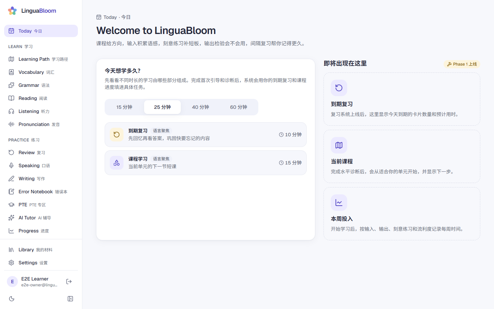
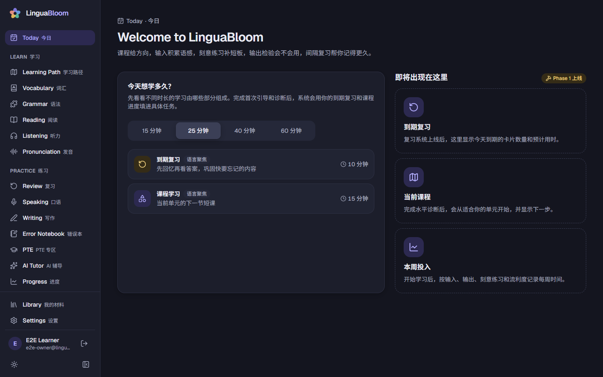
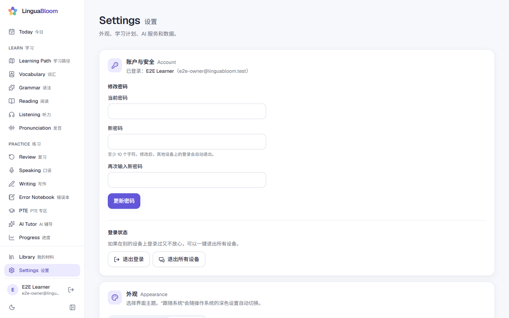
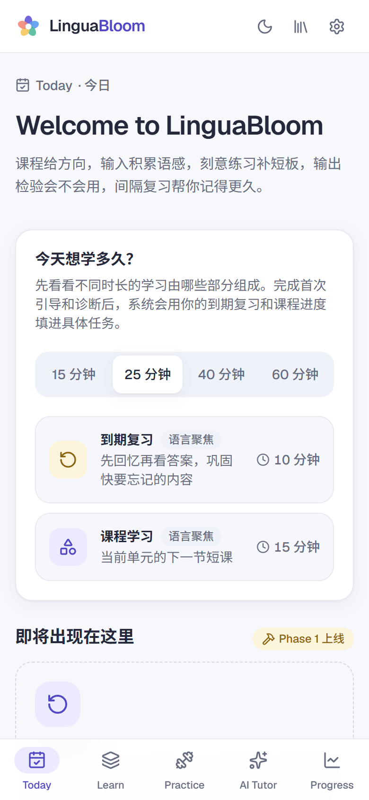

# LinguaBloom

个人私有部署的英语学习工作站：系统课程、真实输入、主动输出、AI 辅导和间隔复习，帮助中文母语学习者从 Pre-A1 长期成长到 C1/C2。

> **当前状态：Phase 2 已完成并通过验收；Phase 3 的 3.1（AI Tutor）和 3.2（写作工作室与 AI 内容生成）已完成（目前用本地模拟 AI 验证）。**
> 写作有分层反馈和第二版对比；AI 可以解释生词、为导入材料补生词表和理解题、按你的等级生成分级材料、为错题写微课，所有生成内容都要你预览确认后才加入。
> AI Tutor 有讲解、练习、对话、角色扮演、纠错、陪你复习、阅读 / 听力教练九种模式，按你各项技能的水平调整说话难度；用量和月度预算在设置里可见。AI 是可选的：不配置时其他功能照常可用。
> 可以导入自己的文章、SRT / VTT 字幕（配音频后能逐句播放、A-B 循环）和 CSV / TSV 词表，先预览、确认后才进入学习库。
> 语法地图按教学顺序排列，有讲解、句子拆解和五种练习；课程、复习、语法、阅读、听力里做错的题自动进入错误本，同一个错误出现两次就安排补救练习，隔天换题再测。
> 新增 12 份原创分级阅读和听力材料：点词查义、自己决定要不要加入词汇库，中文辅助三档；听力先听后看，可以逐句播放、循环、变速，还能逐句听写。
> 首次引导和自适应水平诊断帮你找到起点；“今日”每天按到期复习和课程进度生成计划，每项都写明原因，可以换时长、调整顺序、跳过。
> 已有 10 个可以学习的完整单元（40 节课，Pre-A1 到 B1）。学完的词自动进入 FSRS 间隔复习；“进度”页显示技能估计、词汇掌握差距和四支柱学习时间。
> 接下来是口语练习和实时语音对话（Phase 3 最后一步）。AI 配置方法见 [`docs/OPERATIONS.md`](docs/OPERATIONS.md)。
> 详细进度见 [`docs/IMPLEMENTATION_STATUS.md`](docs/IMPLEMENTATION_STATUS.md)。

## 截图

以下截图来自真实运行的 Docker 部署（`scripts/capture-screenshots.ts` 生成）。

| 今日（浅色） | 今日（深色） |
|---|---|
|  |  |

| 设置与账户安全 | 手机 |
|---|---|
|  |  |

## 功能概览

**现在可用（Phase 0–4）**

- 学习者档案、水平诊断、今日计划、Pre-A1 / A1 课程、词汇与 FSRS 复习、进度统计（Phase 1）。
- 语法工作室、分级阅读、听力工作室、错误本、导入自己的文本 / 字幕 / 词表 / 音频（Phase 2）。
- AI Tutor、写作反馈、AI 内容生成、口语练习（实时语音对话、标准语音模式、朗读跟读）（Phase 3，需要配置 AI；目前只用模拟 AI 验证过）。
- 能力地图（每条 can-do 能力都链接到证明它的练习）、评估历史和更完整的进度统计（Phase 4 第一步）。
- PTE 专区：按考试版本保存的 22 类官方题型说明（带官方来源和复核日期），22 类全部有原创练习（客观题精确判分；口语录音转写后对照或给 AI 辅助反馈；写作的字数和句数检查），计时模式、可保存继续的迷你模拟练习和练习报告（Phase 4）。
- 单用户私有部署：首次打开时创建唯一的 owner 账户，之后初始化自动关闭，不开放注册。
- 登录 / 退出、修改密码、退出所有设备；密码以 Argon2id 存储；登录失败过多会暂时锁定。
- 桌面侧栏 + 手机底部导航，浅色 / 深色 / 跟随系统主题，键盘可操作，满足 WCAG AA 对比度。
- Docker Compose 一键部署，启动时自动执行数据库迁移；健康检查接口；备份、恢复、升级、健康检查脚本。

**按计划上线**

| 阶段 | 内容 |
|---|---|
| Phase 5 | A2–C2 内容与优化 |

## 技术栈

Next.js 16（App Router、Cache Components）· React 19 · TypeScript · Tailwind CSS 4 · Radix UI · PostgreSQL 18 · Drizzle ORM · Better Auth · Zod · Vitest · Playwright · Docker Compose。模块化单体：一个 Next.js 应用 + 一个 PostgreSQL 数据库。技术决策见 [`docs/IMPLEMENTATION_PLAN.md`](docs/IMPLEMENTATION_PLAN.md)。

## 用 Docker 部署

需要 Docker（含 Docker Compose v2）。

1. 获取代码，并基于模板创建 `.env`：

   ```bash
   cp .env.example .env
   ```

2. 编辑 `.env`，至少修改这三项：
   - `APP_SECRET`：长随机值；
   - `POSTGRES_PASSWORD`：只用字母、数字、`-` 和 `_`；
   - `APP_URL`：你在浏览器里打开的地址，例如 `http://localhost:3000`。

   文件里附有生成随机值的命令。

3. 构建并启动：

   ```bash
   docker compose up -d --build
   ```

4. 打开 `APP_URL`。第一次会进入 **初始化** 页面，创建你的账户后会自动登录。

查看状态和日志：

```bash
docker compose ps
```

```bash
docker compose logs -f app
```

```bash
bash scripts/healthcheck.sh
```

服务器能被公网访问时，建议在 `.env` 里设置 `OWNER_SETUP_TOKEN`，或者先设 `OWNER_SETUP_ENABLED=false`，等你准备好再打开，防止别人抢先完成初始化。部署到 HTTPS 域名、反向代理、端口设置等见 [`docs/OPERATIONS.md`](docs/OPERATIONS.md)。

## 环境变量

完整列表和说明见 [`.env.example`](.env.example)。常用的有：

| 变量 | 必填 | 说明 |
|---|---|---|
| `APP_URL` | 是 | 浏览器访问地址；使用 `https://` 时 cookie 自动加上 Secure |
| `APP_SECRET` | 是 | ≥ 32 个字符的随机值，用于签名会话 |
| `POSTGRES_USER` / `POSTGRES_PASSWORD` / `POSTGRES_DB` | 是 | 数据库账户与库名（密码需 URL 安全） |
| `APP_PORT` | 否 | 主机端口，默认 3000；可写成 `127.0.0.1:3000`，只让本机的反向代理访问 |
| `DB_PORT` | 否 | 数据库在本机的端口，默认 5432，只绑定 127.0.0.1 |
| `OWNER_SETUP_ENABLED` | 否 | 是否允许首次初始化，默认 `true` |
| `OWNER_SETUP_TOKEN` | 否 | 设置后，初始化页面需要输入这个口令 |
| `DATABASE_URL` | 本地开发 | 只在 `npm run dev` 和测试时使用；Docker 会用 `POSTGRES_*` 自己拼出连接串 |
| `AI_*` | 否 | Phase 3 使用；未配置时其他功能照常可用 |

密钥只在服务器端读取，从不发送到浏览器。

## AI 与语音

AI 是可选的：不配置时，课程、复习、阅读、听力、语法、错误本和导入都照常可用。在 `.env` 里设置 `AI_ENABLED=true`、`AI_API_KEY` 和 `AI_TEXT_MODEL` 后重启即可启用 AI Tutor、写作反馈和内容生成；口语练习另外需要 `AI_TRANSCRIPTION_MODEL`（标准语音模式），实时对话需要 `AI_REALTIME_MODEL`，老师的声音用 `AI_TTS_MODEL`（不填时用浏览器朗读）。想先试界面，可以设 `AI_PROVIDER=mock`：本地模拟，不联网、不花钱。

- 密钥只在服务器上使用。实时语音的连接也由服务端完成，浏览器拿不到任何密钥。
- 有月度软预算（`AI_MONTHLY_BUDGET`）和用量记录，见“设置 → AI 服务”。
- 语音功能需要通过 **HTTPS 或 localhost** 访问，并在浏览器里允许麦克风；这是浏览器的安全限制。
- 口语录音默认不保存，开始前可以选择；保存的录音和转录都可以删除。

详细说明见 [`docs/OPERATIONS.md`](docs/OPERATIONS.md) 的“AI 服务”。

## 内容与材料

- **课程内容**：放在数据库或版本化种子文件里，不写在页面代码中。编写规范和种子机制见 [`docs/CONTENT_AUTHORING_GUIDE.md`](docs/CONTENT_AUTHORING_GUIDE.md)。目前已导入 7 个 CEFR 等级、Pre-A1 / A1 / A2 / B1 共 10 个完整单元（另有其余单元的蓝图）、40 道水平诊断题、16 份分级阅读 / 听力材料和 20 个语法点（16 个带练习）。标为 published 的单元必须通过发布质量门槛，否则 seed 会失败。
- **导入自己的材料**（文本、Markdown、SRT / VTT 字幕、音频、CSV / TSV 词表）：在“我的材料”里导入，先预览、确认后才进入学习库；只导入你有权使用的内容，仅供个人学习。

## 备份、恢复与升级

```bash
bash scripts/backup.sh
```

```bash
bash scripts/restore.sh backups/linguabloom-<时间>
```

```bash
bash scripts/update.sh
```

备份同时包含 **数据库** 和 **用户文件**（`/app/data`），两者缺一不可：只有数据库会丢失上传的材料和录音，只有文件会丢失学习进度和索引。备份里有你的个人学习数据，请妥善保存。

忘记密码时，可以在服务器上运行下面的命令重设（会同时退出所有设备）：

```bash
docker compose exec app node ops/reset-owner-password.mjs
```

详细步骤、定时备份、回滚和故障排查见 [`docs/OPERATIONS.md`](docs/OPERATIONS.md)。

## 本地开发

需要 **Node.js 24+** 和 Docker（运行 PostgreSQL）。

1. 安装依赖：

   ```bash
   npm install
   ```

2. 按上文创建 `.env`。`DATABASE_URL` 里的密码要和 `POSTGRES_PASSWORD` 一致。

3. 启动数据库、执行 migration 和 seed：

   ```bash
   npm run db:setup
   ```

4. 启动开发服务器：

   ```bash
   npm run dev
   ```

开发模式下可访问 `/design` 查看设计令牌与组件。

| 命令 | 作用 |
|---|---|
| `npm run dev` | 开发服务器 |
| `npm run build` / `npm start` | 生产构建 / 运行构建结果（与 Docker 镜像相同的 standalone 方式） |
| `npm run db:up` | 启动 PostgreSQL 容器并等待健康检查通过 |
| `npm run db:generate` | 根据 `src/db/schema` 的改动生成新的 SQL migration |
| `npm run db:migrate` / `npm run db:seed` | 执行 migration / 导入种子内容（可重复执行） |
| `npm run db:setup` | 依次运行 db:up、db:migrate、db:seed |
| `npm run owner:reset-password` | 本地重设 owner 密码 |
| `npm run lint` / `npm run typecheck` | ESLint / TypeScript |
| `npm run test` | 单元 / 组件测试（不需要数据库） |
| `npm run test:integration` | 集成测试，使用独立测试库 `<库名>_test`（每次清空） |
| `npm run test:e2e` | Playwright 端到端测试（生产构建 + 测试库，端口 3200） |
| `npm run check` | lint + typecheck + test |

- 集成测试和 E2E 测试需要数据库容器在运行（`npm run db:up`）。
- E2E 在本机使用已安装的 Google Chrome。
- `E2E_BASE_URL=<地址> npm run test:e2e` 可以对一个刚部署、尚未初始化的实例跑同一套测试。

修改数据库结构：先改 `src/db/schema/`，运行 `npm run db:generate`，检查生成的 SQL 并和代码一起提交，再运行 `npm run db:migrate`。不要用 `drizzle-kit push`。

## 常见问题

- **打开页面一直跳到初始化页**：数据库里还没有 owner，这是首次运行的正常流程。
- **`Invalid environment configuration`**：`.env` 缺少必填项或格式不对，错误信息会列出具体变量（不会打印密钥的值）。
- **应用容器不健康**：运行 `docker compose logs app`。最常见的原因是数据库密码含有特殊字符，或修改 `POSTGRES_PASSWORD` 时数据库卷已经存在：数据库密码只在第一次创建卷时生效。
- **局域网其他设备打不开**：确认 `APP_PORT` 没有写成 `127.0.0.1:...`，防火墙放行了端口，并把 `APP_URL` 设成实际访问的地址。

更多问题见 [`docs/OPERATIONS.md`](docs/OPERATIONS.md) 的“故障排查”。

## 已知限制

- Phase 5 进行中：A2、B1 各有 2 个完整单元，B2–C2 的内容、推荐改进、离线复习和移动端优化还没做。
- AI 功能（Phase 3）目前只用本地模拟 AI 验证过，接入真实服务后还要验证连通性和回复质量。
- 内容安全策略（CSP）允许内联脚本：Next.js 的部分预渲染与基于 nonce 的 CSP 不兼容。外部脚本、插件、嵌入框架和向外部地址提交表单都已禁止。
- 登录失败次数限制保存在进程内存里，适合单实例部署，重启后清零。
- 备份脚本只覆盖 Docker 部署；本地 `npm run dev` 时的文件保存在 `./data`，需要自行备份。
- 没有邮件找回密码：单用户私有部署通过服务器上的重设命令处理。

## 文档

- [`LinguaBloom_Claude_开发规格.md`](LinguaBloom_Claude_开发规格.md)：完整产品与开发规格
- [`docs/OPERATIONS.md`](docs/OPERATIONS.md)：部署、备份恢复、升级回滚、故障排查
- [`docs/IMPLEMENTATION_PLAN.md`](docs/IMPLEMENTATION_PLAN.md)：实施计划与技术决策
- [`docs/IMPLEMENTATION_STATUS.md`](docs/IMPLEMENTATION_STATUS.md)：已完成内容、测试结果与已知限制
- [`docs/CONTENT_AUTHORING_GUIDE.md`](docs/CONTENT_AUTHORING_GUIDE.md)：课程内容编写规范
- [`docs/AI_PROMPTS.md`](docs/AI_PROMPTS.md)：AI Prompt 规范与版本库
